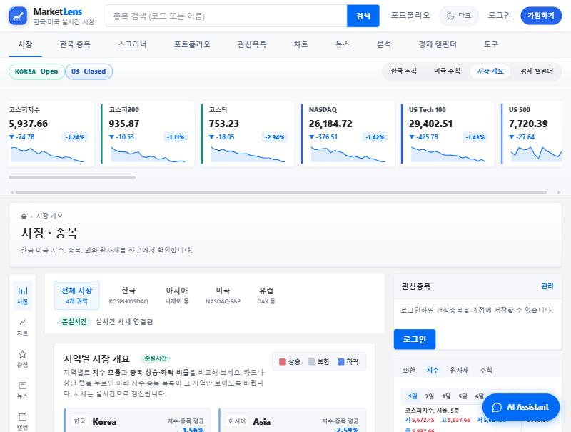

# MarketLens — 한국·미국 주식 대시보드

한국·미국 지수와 종목 시세를 1초마다 갱신해 보여주고, 포트폴리오·관심목록·차트·AI 어시스턴트를 한 화면에서 쓰는 웹 앱입니다.

**배포:** https://marketlens-web-bn64.onrender.com (무료 서버라 첫 접속 때 깨어나는 데 30초쯤 걸립니다)



## 한눈에 보기

| 항목 | 내용 |
| --- | --- |
| 프론트엔드 | Next.js 14 (App Router), TypeScript, Tailwind CSS, React Query, Lightweight Charts |
| 백엔드 | Python, FastAPI, WebSocket, SQLAlchemy(asyncpg) |
| 데이터 | FinanceDataReader(한국), Yahoo Finance(미국), PostgreSQL |
| AI | OpenAI·Gemini 어시스턴트 (앱 시세 스냅샷을 근거로 답변) |
| 품질 | pytest 49개, Playwright e2e 5개(모바일 화면 점검 포함), ruff, pyright |
| 배포 | Docker, Render Blueprint(웹·API·DB 3개 서비스) |

## 핵심 기능

- **실시간 시세:** 백엔드가 시세를 캐시에 모으고, WebSocket으로 1초마다 표·티커·지수에 밀어 줍니다.
- **외부 API가 막혀도 동작:** Yahoo가 요청을 거절(429)하면 캐시나 기본 데이터로 화면을 유지하고, 나중에 다시 시도합니다.
- **차트:** 종목·지수의 분·시간·일봉 차트. 분봉을 못 받으면 일봉으로 대체합니다.
- **포트폴리오·관심목록:** 로그인한 사용자별로 저장 (JWT 인증).
- **AI 어시스턴트:** 지금 보고 있는 화면과 종목 시세를 함께 넘겨서, 앱에 있는 숫자를 근거로 답하게 했습니다. 없는 수치는 지어내지 말고, 매수·매도 권유는 하지 않도록 지시했습니다.

## 트러블슈팅: Render 무료 배포

로컬에서는 잘 되던 앱이 Render에 올리자 세 군데에서 멈췄습니다.

| 문제 | 원인 | 해결 |
| --- | --- | --- |
| API 서버가 켜지자마자 죽음 | Render의 DB 주소(`postgresql://`)를 SQLAlchemy가 설치되지 않은 psycopg 드라이버로 해석 | 주소를 `postgresql+asyncpg://`로 바꾸고 `sslmode=`를 asyncpg 형식 `ssl=`로 변환 ([b1cd9e4](https://github.com/t01040588614-source/marketlens/commit/b1cd9e4)) |
| 브라우저에서 API·WebSocket 호출 실패 | Render가 넘겨준 주소가 내부 이름(`marketlens-api-h3h9`)이라 브라우저가 찾을 수 없음 | 점(.)이 없는 주소는 공개 주소 `https://<이름>.onrender.com`으로 바꾸도록 수정 ([e0760e3](https://github.com/t01040588614-source/marketlens/commit/e0760e3), [832f552](https://github.com/t01040588614-source/marketlens/commit/832f552)) |
| 장중에 502 오류가 반복 | 무료 서버(CPU 0.1개)가 시세 계산 중 5초 헬스체크에 답하지 못해 Render가 강제로 재시작 | API 헬스체크를 빼고, 무료 서버용으로 시세 갱신 간격을 늘림 ([f034ab6](https://github.com/t01040588614-source/marketlens/commit/f034ab6), [c5f72ee](https://github.com/t01040588614-source/marketlens/commit/c5f72ee)) |

---

## 실행·개발 안내

## 빠른 실행

| 파일 | 설명 |
|------|------|
| **`주식대시보드_실행.bat`** | **더블클릭 한 번** — Docker Postgres·계좌·DOCX DB, 백(8000)·프론트(3000), API키 허브, ETL(최초 1회), 점검 후 브라우저 |
| **`주식대시보드_Docker.bat`** | **Docker Desktop** — Postgres+API+Next를 **컨테이너**로 한 번에 빌드·기동 (`docker compose up --build`) |
| **`stop-dev.bat`** | 8000·3000 리스닝 프로세스 종료 |
| **`자동시작_등록.bat`** | **PC 켜고 로그인하면** 90초 후 MarketLens 자동 기동 (작업 스케줄러) |
| **`자동시작_해제.bat`** | 위 자동 기동 등록 해제 |
| **`scripts/verify-stack.ps1`** | health · cache · API · 프록시 · `/korea` 점검 |

### PC 재부팅 후 자동 실행

1. **최초 1회** `주식대시보드_실행.bat`으로 Next.js 빌드까지 완료해 두세요. (이후 자동 기동은 빌드가 있으면 `npm run start`만 사용)
2. **`자동시작_등록.bat`** 더블클릭 → Windows **작업 스케줄러**에 `MarketLens-AutoStart` 등록
3. **Docker Desktop** → *Settings → General* → **Start Docker Desktop when you sign in** 켜기 (PostgreSQL·전체 기능용)
4. 재부팅 후 **로그인 약 90초 뒤** 백엔드(8000)·프론트(3000)가 켜지고, 준비되면 브라우저가 열립니다.
5. 문제 시 로그: `%LOCALAPPDATA%\MarketLens\autostart.log` · 수동 점검: `주식대시보드_실행.bat`

브라우저 자동 열기를 끄려면:  
`powershell -File scripts\install-autostart.ps1 -NoBrowser`

CSS가 꼬였을 때: `stop-dev.bat` 후 `주식대시보드_실행.bat` (기본으로 `.next` 삭제). 빠른 재기동만: `start.bat -SkipClean`.

**시세:** Yahoo `fast_info` 현재가 → 백엔드 캐시(장중 ~1초 fast·구독 종목) → WebSocket 1초 푸시. 표·티커·지수는 같은 캐시 기준입니다.

**차트:** 종목·지수는 Yahoo 분·시간봉 우선(429 시 `download` 재시도). 지수는 FDR 일봉 폴백, **1일** 탭은 Yahoo 복구 시 **5m 등 당일 봉**으로 표시됩니다.

## 구조

| 폴더 | 역할 |
|------|------|
| `stock-backend/` | FastAPI, FDR/Yahoo 시세, WebSocket, PostgreSQL |
| `my-frontend/` | Next.js 14, `/api/v1` 프록시, MarketWebSocketProvider |
| `docs/` | [DOCX 완전판 추출](./docs/spec-from-docx-full.txt), [구현 상태](./docs/SPEC_STATUS.md) |

## 명세·점검 (1·2·3)

1. **명세** — [docs/REQUIREMENTS.md](./docs/REQUIREMENTS.md), [docs/SPEC_STATUS.md](./docs/SPEC_STATUS.md)  
2. **실행 검증** — 서버 기동 후 `powershell -File scripts/verify-stack.ps1`  
3. **우선 기능** — 실시간 WS·차트·포트폴리오·`/search` (체크리스트 참고)

## 환경

- Python 3.11+ (`stock-backend/venv`)
- Node 18+ (`my-frontend`)
- 프론트 `.env.local`: `STOCK_API_PROXY=http://127.0.0.1:8000`

### Render 무료 클라우드 배포 (팀 공유 URL, PC 불필요)

루트 **`render.yaml`** Blueprint → [docs/DEPLOY_RENDER.md](./docs/DEPLOY_RENDER.md)

1. Render → **New → Blueprint** → 이 GitHub repo 연결 → **Apply**
2. 팀에게 **`marketlens-web` HTTPS URL**만 공유

### DOCX 완전판 (PostgreSQL + Docker)

```powershell
copy .env.example .env
docker compose up --build
```

또는 DB만: `docker compose up -d db` + [DOCX_COMPLETE.md](./docs/DOCX_COMPLETE.md)

- ETL: `stock-backend\venv\Scripts\python.exe scripts\ingest_docx_all.py`
- `/stocks`, `/accounts`, Lightweight Charts — [SPEC_STATUS.md](./docs/SPEC_STATUS.md)

실행 bat은 **Docker 있으면 SQLite → Postgres 자동 전환** (전 기능). 시세만 원하면 `stock-backend/.use_sqlite` 빈 파일 생성.

### API 키만 넣으면 연동

1. **UI:** [http://localhost:3000/tools/integrations](http://localhost:3000/tools/integrations) 에서 저장 (개발 모드 기본 허용)  
2. **또는** `stock-backend/.env` / `stock-backend/data/integration_keys.json` (예시: `data/integration_keys.json.example`)

| 키 | 효과 |
|----|------|
| `KIS_APP_KEY` + `KIS_APP_SECRET` | 한국 시세 **KIS 우선** |
| `FINNHUB_API_KEY` / `US_STOCK_API_KEY` | 미국 시세 Finnhub 우선 |
| `ALPHA_VANTAGE_API_KEY` | 미국 시세 (Finnhub 없을 때) |
| `GOOGLE_*` / `KAKAO_*` | 로그인 페이지 소셜 버튼 |
| `NEWS_API_KEY` | `/api/v1/news` NewsAPI 헤드라인 |
| `FCM_SERVER_KEY` | `POST /api/v1/integrations/fcm/test` |

OAuth 콜백 URL은 Google/Kakao 콘솔에  
`{OAUTH_BACKEND_BASE}/api/v1/auth/oauth/google/callback` 등으로 등록하세요.

자세한 내용: [my-frontend/README.md](./my-frontend/README.md), [stock-backend/README.md](./stock-backend/README.md).
